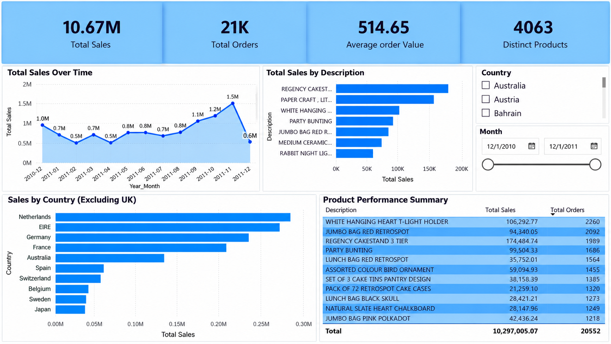

# Business Performance Dashboard

An end-to-end **retail sales analytics and business intelligence dashboard** built with the UCI Online Retail dataset. The project uses Power BI, DAX and a reproducible Python audit to turn invoice-level retail transactions into KPIs, time trends, product performance insights and geographic analysis.

## Project status

**Completed dashboard:** The refreshed Power BI report was inspected in Power BI Desktop, and the KPI cards were verified and validated as recorded during project review. The model contained **531,283 rows** in `Table1` and **5 explicit DAX measures** (`Average order Value`, `Distinct Products`, `Total Orders`, `Total Sales`, and `Total Units Sold`). The KPI values below reflect the validated dashboard/model definitions; gross-versus-net sales treatment and the interpretation of cancellation/credit rows should still be described explicitly when discussing the business meaning of sales.

## Business objective

The dashboard is designed to answer:
- How does sales value change over time?
- Which products and invoice lines contribute most to sales?
- Which international markets contribute most?
- Which data-quality issues could materially distort the results?

## Tech stack

**Power BI** · **DAX** · **Python (pandas audit)** · **Data visualization**

**Dataset:** UCI Online Retail, covering transactions from December 2010 through December 2011.

## Dashboard preview

### Latest dashboard


> Screenshot of the refreshed Power BI report with KPI cards reviewed during validation.

## KPIs

The validated dashboard KPIs are **Total Sales: £10,666,684.54** (displayed as **£10.67M**), **Total Orders: 20,726** (displayed as **21K**), **Average Order Value: £514.65**, and **Distinct Products: 4,063** distinct product descriptions. These figures were verified in the refreshed Power BI report. `Distinct Products` counts descriptions, not units sold. When interpreting Total Sales, state the report's chosen inclusion policy and distinguish gross sales from signed net sales if cancellation/credit rows are in scope.

## Data-quality and interpretation notes

- Use a chronological **Year-Month** key on monthly visuals. A month-name-only axis may combine December 2010 and December 2011.
- Distinguish **gross sales** from **signed net sales**. Signed net sales retains signed cancellation/credit rows so they can offset original transactions; gross sales follows a separately documented inclusion policy.
- Do not treat postage and adjustment entries such as **DOTCOM POSTAGE**, **MANUAL**, and **POSTAGE** as merchandise in product ranking visuals unless the business question explicitly requires them.
- The source includes an extreme-value line for **PAPER CRAFT, LITTLE BIRDIE** (invoice `581483`, 80,995 units at £2.08). The audit script checks the related cancellation/reversal details. Do not remove this line or claim a cancellation offset without verifying the source rows and the policy used by the model.
- Product rankings, order counts and average order value must all use explicitly documented definitions.

## Reproduce the audit

1. Download the [UCI Online Retail dataset](https://doi.org/10.24432/C5BW33).
2. Install dependencies:
   ```bash
   python -m pip install pandas openpyxl
   ```
3. Run:
   ```bash
   python analysis/audit_online_retail.py path/to/Online_Retail.xlsx --output-dir outputs
   ```
4. Open `powerbi/Business_Performance_Dashboard.pbix` in Power BI Desktop and point the model to the local source workbook.
5. Follow the [reconciliation checklist](docs/POWER_BI_REPAIR_CHECKLIST.md) in the `docs/` folder. Reconcile Power BI measures against audit output before publishing final figures.

The raw dataset is not included in this repository because of its size. The audit script does not modify the source workbook.

## Validation status

The KPI cards and displayed figures were verified during review of the refreshed PBIX in Power BI Desktop. The audit script remains available to reproduce source-side calculations and support future changes to the workbook or model. For correct interpretation, keep these definitions explicit:

- **Total Sales:** interpret according to the model's documented inclusion policy; gross sales and signed net sales are not interchangeable.
- **Total Orders:** count distinct invoice IDs according to the model's documented order policy.
- **Average Order Value:** sales numerator divided by the corresponding order count.
- **Distinct Products:** distinct product descriptions, not units sold.
- **Product rankings:** apply the documented non-merchandise exclusions consistently.
- **Monthly trends:** use a chronological Year-Month key so the same month in different years is not combined.

The implementation detail checklist is maintained in [`docs/POWER_BI_REPAIR_CHECKLIST.md`](docs/POWER_BI_REPAIR_CHECKLIST.md); it is a developer worksheet, not a project deliverable.

## Data source and licensing

**Dataset:** Online Retail, UCI Machine Learning Repository, under [CC BY 4.0](https://creativecommons.org/licenses/by/4.0/).

> Chen, D. (2015). *Online Retail* [Dataset]. UCI Machine Learning Repository. https://doi.org/10.24432/C5BW33

The Power BI file contains data derived from this dataset. The project's original code, report design and documentation are released under the [MIT License](LICENSE); that license does not apply to the UCI dataset.

## Author

**Pranjali Sonkamble**

Focus areas: Data Analytics, Business Intelligence, AI/ML and practical data applications.
