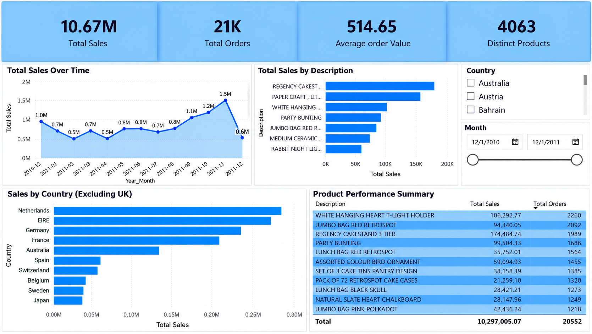

# Business Performance Dashboard

An end-to-end **retail sales analytics and business intelligence dashboard** built with the UCI Online Retail dataset. The project uses Power BI, DAX and a reproducible Python audit to turn invoice-level retail transactions into KPIs, time trends, product performance insights and geographic analysis.

## Project status

**Dashboard repairs are complete and the latest PBIX has been refreshed and saved in Power BI Desktop.** The Year-Month axis and product-visual exclusions have been updated, and the product KPI label distinguishes distinct product descriptions from units sold. The KPI cards have been verified. Power BI Desktop confirms **531,283 rows** in `Table1` and **5 explicit DAX measures** (`Average order Value`, `Distinct Products`, `Total Orders`, `Total Sales`, and `Total Units Sold`). The preview below uses the latest dashboard screenshot. Source-level cancellation completeness and sales inclusion-policy caveats remain documented below.

## Business objective

The dashboard is designed to answer:
- How does sales value change over time?
- Which products and invoice lines contribute most to sales?
- Which international markets contribute most?
- Which data-quality issues could materially distort the results?

## Tech stack

**Power BI** · **DAX** · **Python (pandas audit)** · **Data visualization**

**Dataset:** UCI Online Retail, covering transactions from December 2010 through December 2011.

## Dashboard preview

### Latest dashboard


> Screenshot captured from the latest refreshed and saved Power BI report.

## KPIs

The report shows **Total Sales**, **Total Orders**, **Average Order Value**, and **Distinct Products** (distinct product descriptions, not total units sold). In the current cleaned workbook, the reported checks so far are: sales sum **£10,666,684.54** (displayed as £10.67M), **20,726** distinct invoice IDs (displayed as 21K), AOV **£514.65**, and **4,063** distinct descriptions. These are preliminary source/model checks, not final certified KPIs: the cleaned workbook contains no invoice IDs beginning with `C` and no negative quantity/sales rows, so cancellation completeness and the business definition of net sales remain unverified. Reconcile the figures against the original dataset and the refreshed PBIX before describing them as final.

## Data-quality and interpretation notes

- Use a chronological **Year-Month** key on monthly visuals. A month-name-only axis may combine December 2010 and December 2011.
- Distinguish **gross sales** from **signed net sales**. Signed net sales retains signed cancellation/credit rows so they can offset original transactions; gross sales follows a separately documented inclusion policy.
- Do not treat postage and adjustment entries such as **DOTCOM POSTAGE**, **MANUAL**, and **POSTAGE** as merchandise in product ranking visuals unless the business question explicitly requires them.
- The source includes an extreme-value line for **PAPER CRAFT, LITTLE BIRDIE** (invoice `581483`, 80,995 units at £2.08). The audit script checks the related cancellation/reversal details. Do not remove this line or claim a cancellation offset without verifying the source rows and the policy used by the model.
- Product rankings, order counts and average order value must all use explicitly documented definitions.

## Reproduce the audit

1. Download the [UCI Online Retail dataset](https://doi.org/10.24432/C5BW33).
2. Install dependencies:
   ```bash
   python -m pip install pandas openpyxl
   ```
3. Run:
   ```bash
   python analysis/audit_online_retail.py path/to/Online_Retail.xlsx --output-dir outputs
   ```
4. Open `powerbi/Business_Performance_Dashboard.pbix` in Power BI Desktop and point the model to the local source workbook.
5. Follow [the Power BI repair checklist](docs/POWER_BI_REPAIR_CHECKLIST.md). Reconcile the Power BI measures against audit output before publishing final figures.

The raw dataset is not included in this repository because of its size. The audit script does not modify the source workbook.

## Repair status

- [x] Verify loaded `Table1` row count: **531,283 rows** (Power BI Desktop status bar).
- [x] Count explicit DAX measures in the visible model: **5 measures**.
- [ ] Reconcile sales definitions, cancellation handling, order counts and AOV.
- [x] Repair and sort the Year-Month axis using a distinct `Year_Month` label and `Month_Sort` key (visual check performed; refresh validation still pending).
- [x] Rename the product KPI to **Distinct Products** so it is not confused with units sold; final currency/measure formatting check remains pending.
- [x] Apply visual-level exclusions for `DOTCOM POSTAGE`, `MANUAL`, `POSTAGE`, `CARRIAGE`, and `Bank Charges` to product-ranking visuals; audit the full exclusion policy before calling the merchandise total final.
- [x] Open, refresh, and save the latest PBIX in Power BI Desktop.
- [ ] Independently reconcile filtered product totals against the excluded descriptions and document the inclusion policy.
- [x] Record model counts from Power BI Desktop: **531,283 rows** and **5 explicit DAX measures**.
- [x] Replace the old dashboard previews with `images/Business_Performance_Dashboard.png`.
- [ ] Complete final reconciliation before describing the dashboard figures as verified.

See [POWER_BI_REPAIR_CHECKLIST.md](docs/POWER_BI_REPAIR_CHECKLIST.md) for implementation details.

## Data source and licensing

**Dataset:** Online Retail, UCI Machine Learning Repository, under [CC BY 4.0](https://creativecommons.org/licenses/by/4.0/).

> Chen, D. (2015). *Online Retail* [Dataset]. UCI Machine Learning Repository. https://doi.org/10.24432/C5BW33

The Power BI file contains data derived from this dataset. The project's original code, report design and documentation are released under the [MIT License](LICENSE); that license does not apply to the UCI dataset.

## Author

**Pranjali Sonkamble**

Focus areas: Data Analytics, Business Intelligence, AI/ML and practical data applications.
