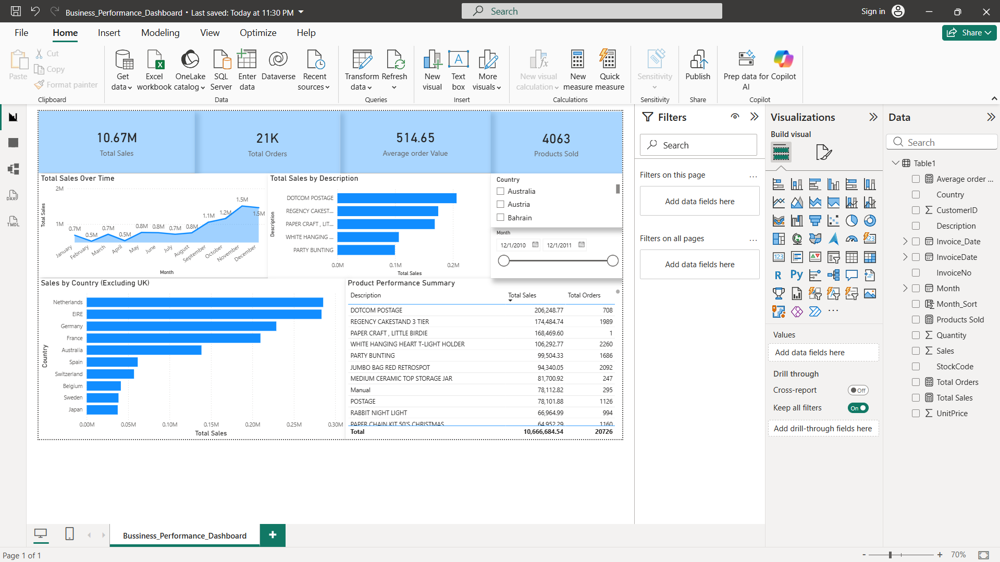
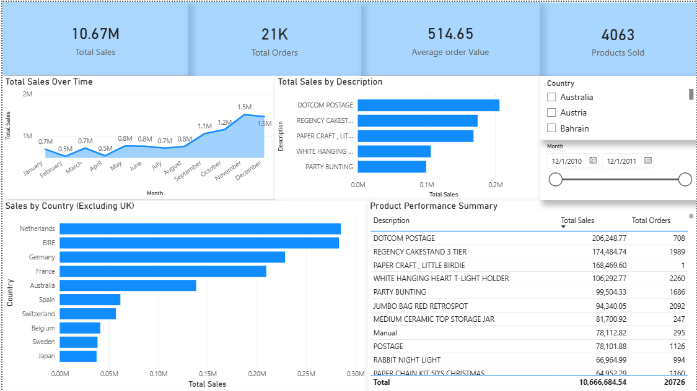

# Business Performance Dashboard

An end-to-end **retail sales analytics and business intelligence dashboard** built with the UCI Online Retail dataset. The project transforms transaction-level data into decision-ready KPIs, trend analysis, product performance insights, and geographic sales analysis.

## 🎯 Business Objective

Provide a single analytical view to answer:

- How is revenue changing over time?
- Which products and order lines drive sales?
- Which international markets contribute the most revenue?
- What data-quality issues could distort product-performance conclusions?

## 🧰 Tech Stack

**Power BI** · **DAX** · **Python (pandas audit/cleaning script)** · **Data Visualization**

**Dataset:** UCI Online Retail — UK-based online retailer, December 2010–December 2011.

## 🔄 Analytical Workflow

```
Raw Transaction Data
        ↓
Python audit / cleaning (reproducible script)
        ↓
Power BI Data Model
        ↓
DAX Measures & KPIs
        ↓
Sales / Product / Geographic Analysis
        ↓
Business Insights
```

## 📊 Dashboard Preview

### Full Dashboard


### KPI & Sales Trend


## 📌 Core KPIs

- **Total Sales:** £10.67M *(existing PBIX figure; not yet reconciled against cancellation handling in the source data)*
- **Orders:** 21K *(existing PBIX figure; definition should be confirmed against distinct invoice numbers)*
- **Average Order Value:** £514.65 *(existing PBIX figure; definition should be confirmed)*
- **Products Sold:** 4,063 *(matches the card label; do not describe as unique products until the measure is verified)*

## 🔍 Key Findings

- Monthly sales should be reviewed using a Year-Month key (for example, `2010-12`, `2011-12`) before stating month-specific totals. The month-name-only visual can combine December 2010 and December 2011.
- Shipping/manual adjustment entries such as **DOTCOM POSTAGE**, **Manual**, and **POSTAGE** can distort product rankings if treated as products; the published product ranking should exclude them explicitly and document the rule.
- **REGENCY CAKESTAND 3 TIER** was the highest product by revenue in the existing analysis; re-check the ranking after cancellation and non-merchandise handling is standardized.
- **WHITE HANGING HEART T-LIGHT HOLDER** combined high order frequency with substantial revenue.
- Among non-UK markets, the Netherlands and EIRE were the leading markets by sales in this analysis.

## 💡 Analytical Takeaway

A dashboard is only as reliable as the definitions and data behind its visuals. Product rankings require distinguishing genuine merchandise from postage and adjustment transactions.

## ▶️ Reproduce the Analysis

1. Download the [UCI Online Retail dataset](https://doi.org/10.24432/C5BW33).
2. Install the Python dependencies `pandas` and `openpyxl` (`pip install pandas openpyxl`).
3. Run `python analysis/audit_online_retail.py path/to/Online_Retail.xlsx --output-dir outputs` to inspect cancellation invoices, the `PAPER CRAFT, LITTLE BIRDIE` lines, adjustment descriptions, and a Year-Month sales series. The script leaves the source file unchanged.
4. Open `powerbi/Business_Performance_Dashboard.pbix` in Power BI Desktop and point the model to your local dataset.
5. Apply and document the chosen cancellation and non-merchandise policy, use a proper Year-Month field, refresh the model, and reconcile KPI totals against the script output before publishing.

Raw data is not included because of size; the project is designed to be reproducible from the public dataset.

## ⚠️ Limitations & Next Steps

- Reconcile gross sales versus net sales, including cancellation/credit-note rows, before presenting Total Sales as final.
- Use a proper Year-Month dimension rather than month name alone.
- Exclude non-product transaction types during product ranking, with an explicit documented list.
- Add customer segmentation and retention analysis.
- Add profitability analysis when cost data is available.

---

## 📄 Data Source & Licensing

**Dataset:** Online Retail, UCI Machine Learning Repository, licensed under [CC BY 4.0](https://creativecommons.org/licenses/by/4.0/).

> Chen, D. (2015). *Online Retail* [Dataset]. UCI Machine Learning Repository. https://doi.org/10.24432/C5BW33

The Power BI file (`powerbi/Business_Performance_Dashboard.pbix`) includes data derived from this dataset. Changes made in this project: cleaning, feature creation, and aggregation for the dashboard.

**Code license:** Original work in this repository (report design, measures, documentation) is released under the [MIT License](LICENSE). The MIT License does not apply to the UCI dataset, which stays under CC BY 4.0.

## 👩‍💻 Author

**Pranjali Sonkamble**

Focused on **Data Analytics, Business Intelligence, AI/ML, and practical data applications**.
